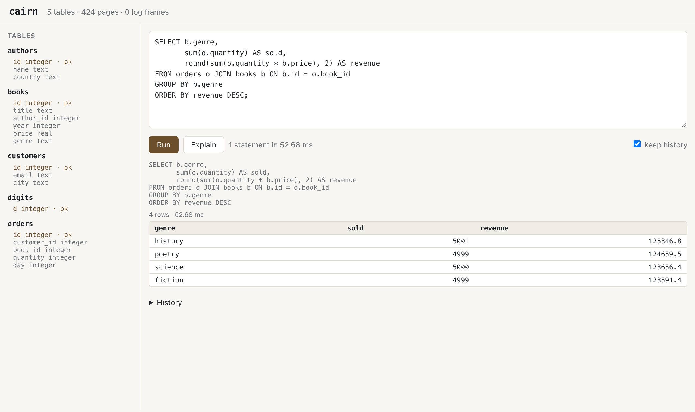

# Cairn

[](https://github.com/integral0909/cairn/actions/workflows/ci.yml)

An embedded relational database written from scratch in Go, using only the
standard library. Cairn stores data in B+trees inside a single file. A
write-ahead log makes commits atomic and durable, and readers get
consistent snapshots that never block the writer. It speaks a practical
dialect of SQL with joins, subqueries, aggregates, indexes and `EXPLAIN`.

You can use it as a Go library (directly or through `database/sql`), from
an interactive shell, or through a small web console.



## Quick start

```sh
go install github.com/integral0909/cairn/cmd/cairn@latest

cairn shop.db < examples/bookstore.sql     # 100 authors, 1,000 books, 10,000 orders
cairn shop.db                              # interactive shell
cairn serve shop.db                        # web console on http://127.0.0.1:8080
```

```
cairn> EXPLAIN SELECT b.title, o.quantity
   ...> FROM orders o JOIN books b ON b.id = o.book_id
   ...> WHERE o.customer_id = 42;
Project b.title, o.quantity
└─ Index nested loop join
   ├─ Index lookup orders AS o using orders_customer (customer_id = 42)
   └─ Rowid lookup books AS b (id = o.book_id)
```

From Go:

```go
import (
	"database/sql"

	_ "github.com/integral0909/cairn"
)

db, err := sql.Open("cairn", "app.db")
_, err = db.Exec(`CREATE TABLE notes (id INTEGER PRIMARY KEY, body TEXT NOT NULL)`)
_, err = db.Exec(`INSERT INTO notes (body) VALUES (?)`, "hello")
var n int
err = db.QueryRow(`SELECT count(*) FROM notes`).Scan(&n)
```

There is also a direct API: `cairn.Open(path, opts)` returns a `*DB` with
`Exec`, `Query`, sessions for explicit transactions, `Check`, `Schema`,
`TableInfo` and `Checkpoint`.

## What it supports

**Statements**
- `CREATE TABLE` with `PRIMARY KEY` (single-column or composite), `UNIQUE`,
  `NOT NULL` and `DEFAULT`. `DROP TABLE`.
- `CREATE [UNIQUE] INDEX`, `DROP INDEX`.
- `ALTER TABLE ... ADD COLUMN` and `RENAME TO`.
- `INSERT ... VALUES | SELECT | DEFAULT VALUES`, with `OR REPLACE`,
  `ON CONFLICT DO NOTHING` and `RETURNING`.
- `UPDATE` and `DELETE`, with `RETURNING`.
- `BEGIN`, `COMMIT`, `ROLLBACK`.
- `EXPLAIN` for any query or change.

**Queries**
- Joins: `INNER`, `LEFT` and `CROSS`, with `ON` or `USING`.
- Subqueries in `FROM` and in expressions: scalar, `IN` and `EXISTS`, either
  correlated or computed once per statement.
- `GROUP BY` and `HAVING`, with `count`, `sum`, `avg`, `min`, `max`,
  `total`, `group_concat`/`string_agg` and `bool_and`/`bool_or`, including
  `DISTINCT`.
- `DISTINCT`, and `ORDER BY` on any expression, alias or position, with
  `NULLS FIRST/LAST`.
- `LIMIT` and `OFFSET`.
- `UNION [ALL]`, `INTERSECT`, `EXCEPT`, and `VALUES` as a query.

**Expressions**
- Arithmetic and `||`.
- Comparisons, `BETWEEN`, `IN`, `LIKE`, `GLOB`, `IS [NOT] NULL` and
  `IS [NOT]`.
- `CASE` and `CAST`.
- Functions: `abs`, `coalesce`, `ifnull`, `nullif`, `iif`, `length`,
  `lower`/`upper`, `trim`, `substr`, `replace`, `instr`, `round`, `sign`,
  `min`/`max`, `concat`, `typeof`, `hex` and `random`.
- Parameters as `?` or `$1`.

**Types** are `INTEGER`, `REAL`, `TEXT`, `BLOB` and `BOOLEAN`, and columns
are strictly typed:
- A value is stored only if it fits the column without losing information.
  `3.0` fits an `INTEGER` column; `3.5` and `'3'` don't.
- Comparing text with numbers is an error, not a guess.
- Integer overflow and division by zero are errors.
- `NULL` follows SQL's three-valued logic. For example, `x NOT IN (1, NULL)`
  is never true.

## How it works

```
cmd/cairn          shell, exec, check, serve (web console + JSON API)
cairn.go           public API; driver.go is the database/sql driver
internal/sql       lexer, recursive-descent parser, AST
internal/engine    catalog, planner, executor, DML/DDL, integrity check
internal/btree     B+trees over pages, with overflow chains and cursors
internal/pager     pages, write-ahead log, snapshots, crash recovery
internal/value     values, order-preserving key encoding, row records
```

**Storage.** The database is a file of 4 KiB pages.

- **Transactions:** a write transaction changes private copies of pages.
  At commit, those pages are appended to a write-ahead log as frames. The
  last frame of a commit carries the new database size, and each frame's
  CRC chains over all the frames before it. Recovery replays exactly the
  committed prefix and ignores torn or stale frames.
- **Snapshots:** readers remember how many frames were committed when they
  started, so they keep a consistent snapshot while the single writer
  keeps committing.
- **Checkpoints** copy the log into the database file when no reader needs
  the old pages. Freed pages are reused.
- **Statement atomicity:** inside an explicit transaction, each statement
  is atomic. A statement that fails halfway is undone through a page
  journal, without ending the transaction.

**Tables and indexes.** A table is a B+tree keyed by rowid. An
`INTEGER PRIMARY KEY` column is the rowid itself. An index is a B+tree
whose keys are the indexed values followed by the rowid.

Keys use an order-preserving byte encoding, so the B-tree compares raw
bytes. Integers and reals interleave by exact numeric value, and text and
blobs are escaped so that tuples compare column by column. Values of any
size spill into overflow pages. The root page of a tree never moves. The
schema lives in its own B-tree as canonical `CREATE` statements.

**Planning.** Statements become trees of iterators over compiled
expression closures, with column references resolved to array positions
ahead of time.

- **Pushdown:** the planner moves each `WHERE` condition to the earliest
  join step that can evaluate it. Conditions on the nullable side of a
  `LEFT JOIN` wait until after that join.
- **Access paths:** for each table it picks a rowid lookup or range, an
  index lookup or range on a prefix of the index columns, or a full scan.
- **Join methods:**
  - an index nested loop when the inner table can be looked up by values
    from the outer row;
  - otherwise a hash join on equality conditions;
  - otherwise a nested loop.
- **Subqueries:** correlated subqueries rerun for each outer row; the
  others run once per statement.

`EXPLAIN` shows the chosen plan.

## Testing

```sh
go test -race ./...
go test ./internal/sql -run '^$' -fuzz FuzzParse
```

- **Pager crash simulation:** in-memory files keep what was synced, plus a
  random prefix of the unsynced writes, the last one possibly torn. After
  hundreds of simulated power cuts, the database always holds exactly the
  last commit.
- **SQL-level crash test:** random transactions through the full engine,
  then a crash, a reopen and an integrity check.
- **B-tree model tests:** random workloads checked against a sorted map,
  verifying structure, both scan directions, and that every page is either
  in a tree or free.
- **SQL logic scripts** in `testdata/sql/` (sqllogictest style) cover joins
  (including the plan each one gets), aggregates, subqueries, set
  operations, indexes, DML edge cases, expressions and schema changes.
- **Randomized index check:** random changes to indexed tables, verifying
  that queries answered through an index always match a full scan.
- **Fuzzing:** the parser and the record decoder are fuzzed. One fuzz
  finding is kept as a regression seed.
- **Other Go tests:** concurrency (snapshot readers alongside a writer,
  concurrent sessions), transactions, persistence, the `database/sql`
  driver, and context cancellation.

`cairn check <file>` (or `.check` in the shell) verifies every B-tree, that
each index matches its table row for row, and that every page is accounted
for.

## Limitations

These are deliberate scope limits, not hidden bugs:

- **One writer at a time.** `BEGIN` takes the write lock until `COMMIT`.
  Reads outside transactions never wait.
- **One process per database file.** There is no cross-process file
  locking yet. Share a `*DB` (or a `database/sql` pool) within one process.
- **Simple planning.** The planner uses rules, not statistics. Joins run in
  the order written; put the most selective table first.
- **Index key size.** Indexed values are limited to about 500 bytes per
  entry. Values in tables can be any size.
- **Not supported:** `RIGHT`/`FULL` joins, window functions, CTEs (`WITH`),
  views, triggers, foreign keys, `CHECK` constraints, and dates as a
  distinct type. Store dates as ISO text or Unix seconds.
- **Performance.** B-tree pages are decoded whole on each visit. That is
  simple and safe, but slower than in-place binary search. Loading the
  bookstore example (about 12,000 rows and its indexes) takes well under a
  second.

## License

MIT. See [LICENSE](LICENSE).
